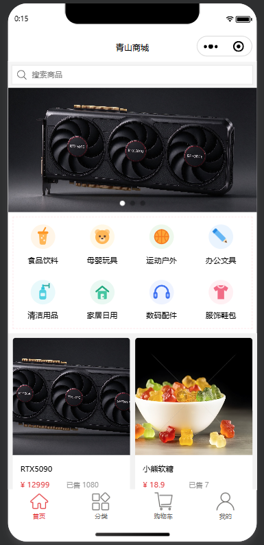
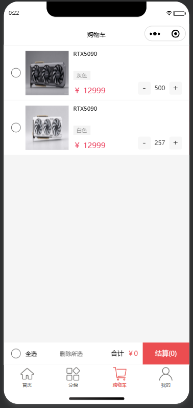
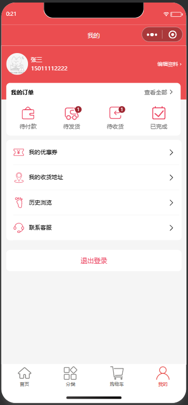
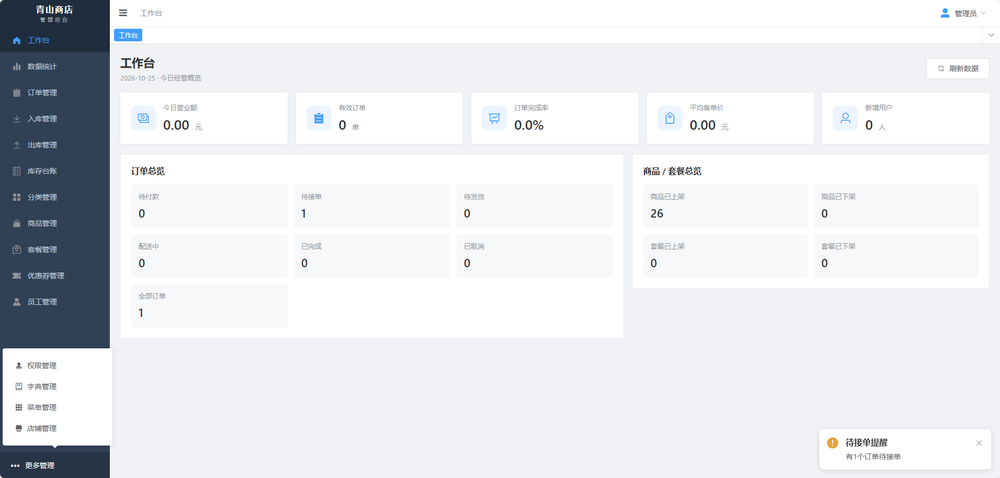
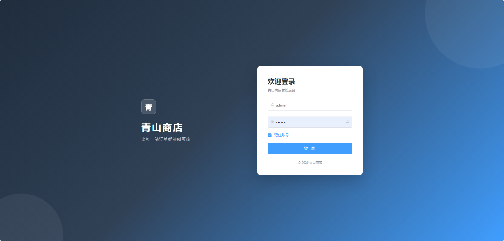

# 青山商店（Qingshan Store）

青山商店是一套面向小型零售 / 门店电商的全栈项目，包含 **微信小程序商城**、**Vue 管理后台** 和 **Spring Boot 后端服务**。系统覆盖商品与 SKU、套餐、购物车、下单支付、订单履约、售后退款、库存出入库、经营报表、员工与角色权限等完整业务链路。

> 当前项目处于开发 / 演示阶段：支付默认使用**模拟支付**；菜单、字典、店铺状态、物流轨迹均已持久化到后端。上线前请务必阅读本文的[安全与上线检查](#安全与上线检查)、[测试与回归清单](docs/测试与回归清单.md) 

- 管理后台使用教程：[docs/后台管理系统使用教程.md](docs/后台管理系统使用教程.md)
- 测试与回归清单：[docs/测试与回归清单.md](docs/测试与回归清单.md)
- 性能基线测试：[docs/性能基线测试.md](docs/性能基线测试.md)
- 管理端接口导出：[docs/青山商店-管理端接口.json](docs/青山商店-管理端接口.json)
- 用户端接口导出：[docs/青山商店-用户端接口.json](docs/青山商店-用户端接口.json)

---

## 项目展示

### 微信小程序

<table>
  <tr>
    <td align="center"><br><sub>首页</sub></td>
    <td align="center"><br><sub>购物车</sub></td>
    <td align="center"><br><sub>我的</sub></td>
  </tr>
</table>

### 管理后台

<p align="center">
  
  <br><sub>工作台</sub>
</p>

<p align="center">
  
  <br><sub>登录页</sub>
</p>

---

## 系统架构

```text
┌──────────────────────┐        HTTP /api          ┌──────────────────────────┐
│  admin-web (Vue 2)   │ ───────────────────────▶ │                          │
│  浏览器管理后台       │        WebSocket /ws      │    qingshan-server       │
└──────────────────────┘ ◀─────────────────────── │                          │
                                                   │                          │
┌──────────────────────┐        HTTP               │  Controller / Service    │
│  applet (微信小程序)  │ ───────────────────────▶ │  MyBatis / 定时任务       │
└──────────────────────┘                           └───────────┬──────────────┘
                                                              │
                         ┌────────────────────────────────────┼────────────────────┐
                         ▼                                    ▼                    ▼
                    ┌─────────┐                          ┌─────────┐        ┌─────────────┐
                    │  MySQL  │                          │  Redis  │        │    OSS      │
                    │  业务库  │                          │ 缓存/状态│       │  商品图片    │
                    └─────────┘                          └─────────┘        └─────────────┘
```

- 管理端通过 `token` 请求头访问 `/admin/**`；小程序通过 `authentication` 请求头访问 `/user/**`。
- WebSocket 地址为 `/ws/{sid}`，管理端登录后连接，接收来单、待接单和催发货消息。
- 订单定时任务每分钟扫描一次，超时未支付订单默认 15 分钟后自动取消并回滚库存。
- Redis 同时用于商品缓存、店铺营业状态、登录失败限流和订单定时任务分布式锁。

---

## 快速开始


### 初始化数据库

开发 / 演示环境（在仓库根目录执行）：

```bash
# 需要彻底重置时先执行 drop-dev.sql
mysql -u root -p --default-character-set=utf8mb4 < mysql/schema.sql
mysql -u root -p --default-character-set=utf8mb4 < mysql/seed-base.sql
mysql -u root -p --default-character-set=utf8mb4 < mysql/seed-demo.sql
```

生产环境只执行：

```bash
mysql -u root -p --default-character-set=utf8mb4 < mysql/schema.sql
mysql -u root -p --default-character-set=utf8mb4 < mysql/seed-base.sql
```

> ⚠ 种子管理员初始密码为 `admin / 123456`，且 `must_change_password=1`，首次登录必须修改密码后才能使用其他功能。新增员工由后端生成随机初始密码，只返回一次。

### 启动 Redis

```bash
redis-server
# 如设置了密码，记下密码，后续填写到 application-dev.yml
```

### 配置并启动后端


`apps/backend/qingshan-server/src/main/resources/application-dev.yml`

```yaml
qingshan:
  datasource:
    driver-class-name: com.mysql.cj.jdbc.Driver
    host: localhost
    port: 3306
    database: qingshan-store
    username: root
    password: { your_mysql_password }
  redis:
    host: localhost
    port: 6379
    password: { your_redis_password }
    database: 7
  alioss:
    endpoint: oss-cn-beijing.aliyuncs.com
    access-key-id: { your_access_key_id }
    access-key-secret: { your_access_key_secret }
    bucket-name: { your_bucket_name }
  jwt:
    admin-secret-key: { replace-with-a-random-admin-secret-at-least-32-bytes }
    user-secret-key: { replace-with-a-random-user-secret-at-least-32-bytes }
  order:
    # 开发环境开启模拟支付接口
    mock-pay-enabled: true
```
构建并启动：

```bash
cd apps/backend
mvn -pl qingshan-server -am clean package -DskipTests
java -jar qingshan-server/target/qingshan-server-1.0-SNAPSHOT.jar
```

或开发模式：

```bash
cd apps/backend
mvn -DskipTests install
cd qingshan-server
mvn spring-boot:run
```


### 启动管理后台

```bash
cd apps/admin-web
npm install
npm run serve
```
- 默认账号：`admin` / `123456`

### 运行微信小程序

1. 用微信开发者工具「导入项目」，目录选择 `apps/applet`。
2. 在 `apps/applet/project.config.json` 中替换为自己的小程序 `appid`，或直接使用测试号。
3. 修改 `apps/applet/config.js`：

```js
export default {
  version: '0.1.0',
  baseURL: 'http://192.168.1.8:8080',
  // 开发环境使用弹窗模拟支付
  mockPay: true,
  shopName: '青山商城',
  shareProfile: '青山商城',
  phoneNumber: '188700000000'
}
```

4. 开发者工具「详情 → 本地设置」勾选「不校验合法域名」，或为正式域名配置 HTTPS 后关闭该选项。
5. 编译运行。小程序当前使用手机号注册 / 密码登录，可直接完成浏览、下单和模拟支付流程；微信一键登录 UI 尚未接入。

---
## 提交前建议执行：

```bash
# 管理端
cd apps/admin-web
npm run lint
npm run build

# 后端：单元测试 + 生产包
cd apps/backend
mvn test
mvn -pl qingshan-server -am clean package -Pprod-package -DskipTests

# 依赖漏洞扫描（需要网络；OWASP 建议配置 NVD_API_KEY）
mvn -B dependency:tree -DoutputFile=../../logs/dependency-tree.txt
cd ../..
python scripts/osv-scan.py logs/dependency-tree.txt logs/osv-scan.md
```

测试与回归范围见 [docs/测试与回归清单.md](docs/测试与回归清单.md)，1 万订单量级冒烟步骤见 [docs/性能基线测试.md](docs/性能基线测试.md)

